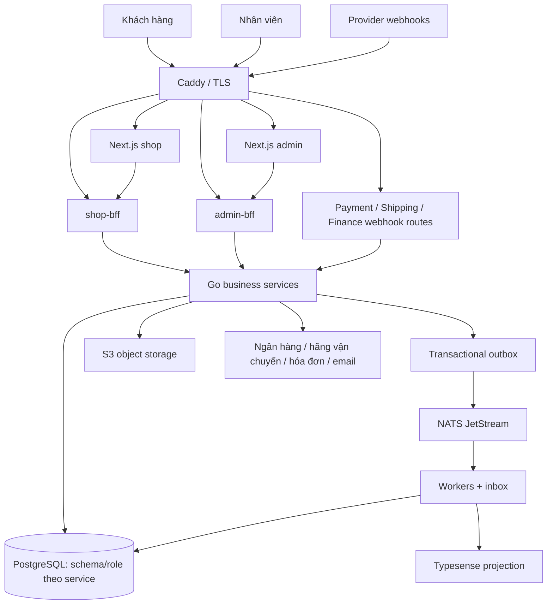

# Minibox — Tài liệu thiết kế kỹ thuật

Phiên bản: 1.0 — Ngày lập: 14/11/2026.

Trạng thái: thiết kế triển khai, chưa có mã ứng dụng, hạ tầng chạy thật hoặc nghiệm thu tích hợp. Tài liệu quy định kiến trúc, dữ liệu, hợp đồng và các bước để Claude Code triển khai. Giá trị kinh doanh `CFG` trong tài liệu nghiệp vụ vẫn chờ PO duyệt; ví dụ dưới đây không tự phê duyệt các giá trị đó.

## 1. Ràng buộc và nguyên tắc

### 1.1 Các quyết định phải giữ

- Minibox là bên bán duy nhất; Việt Nam/VND/tiếng Việt trước, chuẩn bị đa thị trường/ngôn ngữ/tiền tệ/múi giờ.
- Hai frontend Next.js: `shop`, `admin`; mỗi frontend dùng Go BFF riêng: `shop-bff`, `admin-bff`.
- Backend nghiệp vụ là Go microservices, có ranh giới dữ liệu và API độc lập. Không đổi thành monolith nếu chưa có quyết định thay đổi kiến trúc của PO.
- PostgreSQL; mỗi service sở hữu một schema và credential riêng; database as code nằm ngoài mã backend và có pipeline triển khai riêng.
- Monorepo rõ `frontend/`, `backend/`, `database/`, `infra/`, `docs/`.
- Homeserver Ubuntu Server, Docker Compose, GitHub/GitHub Actions Free; local/staging/production tách biệt. Hiện chỉ xác nhận có domain `minibox.vn`; chưa có cấu hình máy/mạng.
- RPO mục tiêu ≤ 1 giờ; RTO 4–8 giờ. Không tuyên bố HA trên một homeserver.
- Mobile/tablet có hành vi như ứng dụng, không chỉ thu nhỏ desktop; cả shop và admin.

### 1.2 Các nguyên tắc triển khai

`ADR-01`: microservices theo năng lực nghiệp vụ; không tách service theo từng bảng hoặc CRUD. BFF chỉ điều phối giao diện, không sở hữu đơn hàng, tiền, tồn hoặc logic giấy phép.

`ADR-02`: transaction ACID trong schema sở hữu; xuyên service dùng saga, outbox/inbox và idempotency. Không distributed transaction hoặc truy vấn chéo schema để “đơn giản hóa”.

`ADR-03`: ghi sổ tiền/xu/kho bất biến; sửa sai bằng bút toán đối ứng/điều chỉnh. Không sửa trực tiếp balance để chữa dữ liệu.

`ADR-04`: tích hợp luôn có adapter, capability matrix, sandbox và trạng thái chưa xác minh. Mock passing không đồng nghĩa production acceptance.

`ADR-05`: chọn giải pháp có thể tự vận hành ở quy mô nhỏ; triển khai dần service theo mốc. Không bật toàn bộ stack chưa dùng chỉ để có đủ container.

`ADR-06`: policy/config có version và effective time. Giao dịch lưu snapshot; thay cấu hình không hồi tố đơn, license hoặc giá đã chốt.

## 2. Bộ công nghệ được chọn

Đây là baseline kỹ thuật do người dùng ủy quyền lựa chọn. M0 phải pin phiên bản stable còn được hỗ trợ, kiểm tra tương thích và giấy phép, ghi lockfile/image digest trong `infra/versions.lock.yaml`; không dùng tag `latest`. Không đoán bản phát hành mới nhất từ ngày tài liệu.

| Lớp | Lựa chọn | Lý do và giới hạn |
|---|---|---|
| Frontend | Next.js App Router, React, TypeScript strict | SSR/SEO cho shop, route/layout riêng; self-host bằng image standalone |
| Workspace JS | pnpm workspace, Node.js LTS | Lockfile thống nhất, build theo package thay đổi |
| UI | Tailwind CSS, Radix primitives qua shadcn/ui, Lucide | Kiểm soát giao diện khối hộp; component có ownership trong repo |
| Form/data | React Hook Form + Zod; TanStack Query/Table cho admin và client state | Server là nguồn xác thực cuối; không lưu server state trùng nhiều nơi |
| i18n | next-intl, message keys và nội dung dịch theo locale | `vi-VN` mặc định; ngôn ngữ không quyết định tiền tệ |
| 3D | Three.js + React Three Fiber, GLB/glTF | Lazy-load cảnh chọn lọc, ảnh dự phòng; test WebGL/device |
| Go API | Go stable, `net/http` + chi | Nhẹ, router rõ, middleware kiểm soát được |
| DB access | pgx + sqlc | Query SQL có kiểu; schema lấy từ database source; không ORM tự migrate |
| DB migration | Goose SQL, migration runner riêng | Versioned SQL; upgrade có kiểm thử, không app tự chạy DDL |
| Giao tiếp sync | HTTP JSON, OpenAPI 3.1 | Dễ debug, client Go/TS sinh từ contract; chưa cần gRPC |
| Async | NATS JetStream | Durable consumers, replay, at-least-once; luôn có inbox/outbox |
| Database | PostgreSQL, một cluster riêng mỗi môi trường | Mỗi service schema/role; PG18 là candidate cần kiểm chứng extension/tool trước pin |
| Search | Typesense | Facet/typo/sort, locale Việt và trường bỏ dấu; dữ liệu có thể rebuild |
| Object storage | S3 API; SeaweedFS cho homeserver | Bucket private/public tách; single-host không có HA; test S3 subset bắt buộc |
| Cache ban đầu | Cache HTTP/CDN tùy chọn + local cache có TTL | Không thêm Redis/Valkey trước khi có nhu cầu đo được; state quan trọng trong PostgreSQL |
| Proxy/TLS | Caddy | Một cổng vào, TLS, request limit, routing; không public DB/service nội bộ |
| Telemetry | OpenTelemetry, Prometheus, Grafana; log JSON/Loki theo profile | Retention/giới hạn để không chiếm đĩa; trace sampling |
| Backup | pgBackRest cho PostgreSQL; restic/snapshot nhất quán cho object/config | Bản sao ngoài nhà; kiểm tra khôi phục toàn bộ liên kết |
| Tests | Go test, PostgreSQL thật qua container; Vitest, Testing Library, Playwright, axe, k6 | Kiểm tra invariant/luồng thật, không chỉ snapshot giao diện |
| CI/security | GitHub Actions, govulncheck, dependency scan, Trivy, secret scan | Job theo path, cache, retention ngắn; không mặc định có tính năng trả phí |

Next.js có hướng dẫn self-host và reverse proxy; sqlc sinh code từ SQL; Goose hỗ trợ migration SQL. Các lựa chọn trên là thiết kế Minibox, không phải bảo đảm tương thích trước khi chạy spike M0. Tham chiếu: [Next.js self-host](https://nextjs.org/docs/app/guides/self-hosting), [sqlc](https://sqlc.dev/), [Goose](https://pressly.github.io/goose/).

## 3. Kiến trúc tổng thể



Public host đề xuất: `minibox.vn` và `www` redirect canonical; `admin.minibox.vn`; `media.minibox.vn` cho asset public; `staging.minibox.vn`, `admin.staging.minibox.vn`. `/api/*` trên mỗi frontend host route đến BFF tương ứng để same-origin cookie. Webhook dùng route được allowlist riêng, không đi qua frontend hoặc nhận credential trình duyệt.

Không cần public `api.minibox.vn` cho toàn bộ service. SSR Next.js gọi BFF qua internal URL nhưng phải chuyển identity context đúng; không tin header tự khai từ browser. BFF không có role ghi vào schema nghiệp vụ.

## 4. Ranh giới service và quyền sở hữu dữ liệu

Định nghĩa 16 service nghiệp vụ đích và hai BFF; mỗi service có API/worker chung codebase, có thể chạy process riêng khi cần. Số service nhiều hơn một ứng dụng đơn nhưng phù hợp phạm vi đã yêu cầu; profile Compose kích hoạt theo mốc để tránh chi phí vận hành sớm.

| Service / schema | Dữ liệu và trách nhiệm sở hữu | Không sở hữu |
|---|---|---|
| `identity-service` / `identity` | Customer/admin principals tách realm, login identities, sessions, MFA, grants, scope, guest claim | Đơn và ví tiền |
| `catalog-service` / `catalog` | Sản phẩm/variant/SKU, taxonomy, thuộc tính, price book, nguồn quyền, policy snapshot reference, publication | Stock, BOM thực, entitlement |
| `order-service` / `orders` | Cart/quote, promotion, order/lines, fulfillment/payment plan, order saga, consent snapshots | Tiền vào ngân hàng, ledger kho/xu |
| `payment-service` / `payments` | Payment intents/receipts/allocations, customer monetary ledger, refund execution, bank adapter, COD reconciliation | AP nhà cung cấp, giấy phép |
| `loyalty-service` / `loyalty` | Xu ledger/lots/holds/earn/reversal/expiry/guest claims | Tiền mặt, lưu thẻ |
| `inventory-service` / `inventory` | Kho/bin, lot/serial/container, stock ledger/reservations/transfers/counts | Lịch máy, công nợ |
| `manufacturing-service` / `manufacturing` | Farm/máy, BOM/routing versions, work orders/batches, usage records, QC, maintenance, cost facts | Tồn chính thức và thu tiền |
| `procurement-service` / `procurement` | Nhà cung cấp, purchase orders, expected receipts, supplier returns | Ledger tồn, chi tiền/AP |
| `shipping-service` / `shipping` | Packing rules/packages, shipments, carrier adapters, rate/label/tracking, carrier fee facts | Quyết định trả tiền/xu |
| `digital-service` / `digital` | Digital offerings/licenses/releases, grants/entitlements/download attempts/revocations | File vật lý trong storage, tiền thực nhận |
| `finance-service` / `finance` | AP, disbursement, expenses, finance projections, legal entities, invoice adapter | Sửa ledger thu tiền khách hoặc làm full accounting |
| `content-service` / `content` | CMS, media metadata/upload/scan/publish, themes/menu/banner, translations | Quyền tải file thương mại, sản phẩm/SKU |
| `customer-care-service` / `care` | Tickets, RMA/refund decisions, warranty, reviews/Q&A/comments, moderation, wishlist/restock subscriptions | Thực hiện hoàn tiền hay cộng kho trực tiếp |
| `notification-service` / `notification` | Templates/versions, preferences, email/in-app delivery/dedup | Nội dung quyết định nghiệp vụ hoặc marketing tự phát |
| `search-service` / `search` | Index jobs/checkpoints, search projection/API | Giá/stock chính thức; Typesense chỉ bản đọc |
| `reporting-service` / `reporting` | Read models, metric definitions, export jobs, reconciliation reports | Cross-schema SQL hoặc transaction nghiệp vụ |

BFF stateless về nghiệp vụ. Session record thuộc identity; BFF giữ cookie opaque tham chiếu phiên, không có bảng user riêng. Không tạo service `common` để cho mọi service ghi dữ liệu chung. Thư viện shared chỉ có logging, auth client, telemetry, money types, event envelope và API primitives; không dùng chung domain model persistence.

Hồ sơ media/content lưu object metadata; digital tham chiếu immutable asset ID và quyết định quyền tải. Notification có thể lưu snapshot tối thiểu địa chỉ nhận với retention; không trở thành kho customer độc lập. Reporting/finance xây projection từ event và API export theo quyền, không join bảng private của service khác.

## 5. Cấu trúc monorepo

```text
minibox/
  AGENTS.md                         # quy tắc chung được tạo ở M0
  frontend/
    apps/shop/
    apps/admin/
    packages/ui/                    # tokens, primitives, accessibility
    packages/api-client/            # generated từ OpenAPI
    packages/i18n/
    package.json
    pnpm-workspace.yaml
    pnpm-lock.yaml
  backend/
    bff/shop-bff/
    bff/admin-bff/
    services/<service>/
      cmd/api/
      cmd/worker/
      internal/domain/
      internal/application/
      internal/ports/
      internal/adapters/http/
      internal/adapters/postgres/   # SQL query + sqlc generated; không DDL
      internal/adapters/providers/
      tests/
      go.mod
      Dockerfile
    packages/platform/             # module hẹp, không shared business DB
    go.work                        # local coordination, không thay version deps
  contracts/
    openapi/<service>/v1.yaml
    events/<domain>/<event>.v1.schema.json
    examples/                      # không PII thật
  database/
    bootstrap/                     # role/schema/privilege, privileged job
    services/<schema>/migrations/  # canonical SQL DDL
    services/<schema>/fixtures/    # dev/test only
    services/<schema>/verify/      # invariants, denied cross-schema
    checksums/                     # immutable migration manifest
    tooling/                       # migration image, verify/drift scripts
    releases/                      # version manifest theo schema
  infra/
    compose/{base,local,staging,production}.yaml
    config/                        # không secrets
    proxy/
    monitoring/
    backup/
    scripts/                       # deploy/rollback/restore; ps1 + sh entry
    versions.lock.yaml
  docs/
    business-requirements.md
    technical-design.md
    adr/                           # tạo khi triển khai
    runbooks/
    acceptance/<milestone>/
  .github/workflows/
```

Các đường dẫn ngoài hai tài liệu này là cấu trúc cần tạo khi triển khai, chưa có trong workspace. Không tạo file boilerplate chỉ để biểu diễn chúng. Source tiếng Anh; docs/nhãn sản phẩm tiếng Việt. Lệnh phát triển phải có entry point chạy được trên Windows PowerShell và Ubuntu; Docker build là môi trường chuẩn. Không đặt bí mật vào `.env.example`.

Mỗi module Go build/test độc lập ngoài `go.work` để phát hiện phụ thuộc bị che. Contract thay đổi trong cùng PR với client và migration liên quan; không yêu cầu mọi service deploy đồng thời.

## 6. Database as code và mô hình dữ liệu

### 6.1 Cách ly thật

- Production và staging dùng PostgreSQL container/volume/network/credential riêng; không chỉ hai schema trong cùng database.
- Trong mỗi môi trường: một database ứng dụng với schema theo service; `orders_runtime`, `payments_runtime`... chỉ DML schema của mình. Không dùng superuser/owner làm app credential.
- Tách role `*_owner` NOLOGIN, `*_migrator` dùng job DDL, `*_runtime` cho API/worker. Credential migration không có trong container runtime.
- Revoke CREATE mặc định trên `public`, revoke quyền không cần từ PUBLIC; cố định `search_path`, qualify schema trong query/migration; extension chỉ do bootstrap cấp và có allowlist.
- Không cross-schema FK, view, trigger, function gọi DB khác. FK trong schema, reference UUID ngoài schema và validation qua API/event. Không chia sẻ table `users` để join mọi nơi.
- SQL privileges ngăn truy cập schema; farm/kho scope kiểm ở application cho mỗi command/query/export, có test vượt quyền. Nếu thêm RLS thì là defense-in-depth với transaction-local context, không thay kiểm tra API.
- CI đăng nhập đúng runtime role và chứng minh SELECT/INSERT/DDL sang schema khác bị từ chối. `search_path` một mình không tạo biên bảo mật.

### 6.2 Migration lifecycle

Canonical DDL chỉ trong `database/services/<schema>/migrations`. Backend query/sqlc đọc schema build artifact sinh từ migration; không có bản DDL độc lập bị lệch. Migration version tăng đơn điệu theo schema; checksum sau khi merge không sửa. Mỗi schema có migration bookkeeping riêng, được tạo/cấu hình đúng namespace.

Pipeline database: lint SQL → migrate database sạch → seed fixture → assertions → nâng cấp từ release gần nhất → kiểm tra contract/query → privilege tests → schema drift diff → đóng migration image/manifest. Migration job có advisory lock, timeout, preflight size/lock và lưu report. Runtime không auto-migrate khi start.

Expand/contract: thêm trường nullable/compatible → deploy code đọc hai dạng nếu cần → backfill theo batch có checkpoint → kiểm chứng → chuyển đọc/ghi → release sau mới drop/NOT NULL. Index concurrent chạy theo cơ chế non-transactional riêng đã kiểm thử. Không chạy migration khóa bảng lâu mà không có kế hoạch maintenance.

Rollback app không đồng nghĩa rollback schema. Ưu tiên forward fix; `down` không tự chạy trên production. Migration phá hủy cần backup/restore rehearsal, duyệt cụ thể và downtime plan. Database release độc lập nhưng release manifest ghi app version tương thích và schema min/max. Migrate trước khi deploy app cần cột mới, readiness chặn khi không tương thích.

### 6.3 Quy ước kiểu dữ liệu

| Dữ liệu | Quy ước |
|---|---|
| ID | UUID do ứng dụng sinh bằng thư viện đã kiểm thử; public order number riêng, không dùng mã dễ đoán làm authorization |
| Money | `amount_minor BIGINT`, `currency CHAR(3)`; API truyền chuỗi số để tránh mất chính xác JS; không float |
| Tỷ lệ/thuế/quy đổi | Decimal chính xác, basis points nếu phù hợp; quy tắc rounding có version |
| Số lượng | `NUMERIC(20,6)` cho vật tư; số nguyên cho chiếc/serial; unit code và conversion theo vật tư |
| Thời điểm | `timestamptz`, UTC; IANA timezone riêng cho lịch làm việc; date-only dùng `date` |
| Version | `version BIGINT` optimistic concurrency; trạng thái chuyển với expected version |
| Nội dung đa ngôn ngữ | Table translation unique `(entity_id, locale)`, fallback rõ; không trộn locale và market |
| Chính sách | Policy ID/version + snapshot JSONB validated schema; không dùng JSONB thay toàn bộ quan hệ |
| PII | Trường tối thiểu cần thiết, encrypted secret; audit/log mask; dữ liệu không cần giữ có retention |

Giá VND ban đầu scale 0, nhưng không hardcode mọi currency có 2 chữ số. Không dùng exchange rate hiện tại để sửa báo cáo lịch sử. Snapshot tiền tệ giao dịch, settlement và reporting rate (tương lai). Lịch mở cửa/expiry có UTC timestamp tính từ timezone policy; test DST cho mở rộng, không chỉ UTC+7.

### 6.4 Thực thể cốt lõi theo schema

| Schema | Tables cốt lõi và constraint |
|---|---|
| identity | `principals`, `login_identifiers`, `external_identities`, `sessions`, `mfa_credentials`, `roles`, `grants`, `guest_claims`; unique provider+subject và normalized login |
| catalog | `products`, `variants`, `attribute_definitions`, `variant_values`, `translations`, `prices`, `rights_records`, `publication_versions`; unique SKU, valid combination |
| orders | `carts`, `quotes`, `orders`, `order_lines`, `discount_allocations`, `coin_allocations`, `fulfillment_plans`, `payment_obligations`, `sagas`, `order_changes`; idempotency key unique |
| payments | `intents`, `provider_transactions`, `receipts`, `allocations`, `ledger_entries`, `refunds`, `cod_settlements`, `webhook_inbox`; unique provider transaction ID |
| loyalty | `accounts`, `coin_lots`, `coin_entries`, `holds`, `hold_allocations`, `earnings`, `claim_records`; source event unique, nonnegative spendable balance |
| inventory | `warehouses`, `bins`, `stock_items`, `lots`, `serials`, `containers`, `movements`, `balances`, `reservations`, `transfers`, `counts`; unique stock dimension và serial |
| manufacturing | `farms`, `machines`, `bom_versions`, `bom_components`, `routings`, `work_orders`, `batches`, `batch_demands`, `usage`, `qc_results`, `maintenance`; output allocation ≤ accepted quantity |
| procurement | `suppliers`, `purchase_orders`, `purchase_lines`, `receipt_expectations`, `supplier_returns`; receive/return quantity bounded |
| shipping | `packages`, `package_lines`, `shipments`, `carrier_attempts`, `tracking_events`, `rate_quotes`; unique provider shipment code, source reference |
| digital | `offerings`, `license_versions`, `releases`, `entitlements`, `grants`, `download_attempts`; unique order-line grant, immutable released asset |
| finance | `legal_entities`, `entity_versions`, `payables`, `disbursements`, `expenses`, `invoice_requests`, `invoices`, `finance_projections`; provider invoice ref unique |
| content | `posts`, `post_versions`, `media_assets`, `upload_sessions`, `scan_results`, `menus`, `banners`, `pages`, `translations` |
| care | `tickets`, `messages`, `returns`, `return_lines`, `warranties`, `reviews`, `moderation_actions`, `wishlists`, `restock_subscriptions`; review eligibility proof |
| notification | `templates`, `preferences`, `notifications`, `deliveries`; unique event+recipient+template+channel |
| search/reporting | `projection_offsets`, `rebuild_jobs`, read models/exports; source aggregate version và completeness watermark |

Mỗi service ghi nghiệp vụ có `outbox_events`, `inbox_events`, `idempotency_records`, `audit_events` trong schema riêng. Không tạo một bảng outbox dùng chung với quyền ghi của tất cả service.

## 7. Hợp đồng API và sự kiện

### 7.1 HTTP

Prefix `/v1`, resource ID opaque, cursor pagination, filter/sort allowlist. Error theo cấu trúc problem details: `type`, `title`, `status`, `code`, `trace_id`, field errors không chứa bí mật. `409` cho version conflict/nguồn lực đổi; `422` dữ liệu không hợp lệ; `202` cho tác vụ đang chờ, không giả `200 completed`.

Mọi command có ảnh hưởng tiền/xu/kho/đơn có `Idempotency-Key`. Scope key theo actor + route + operation; lưu hash payload và kết quả/reference trong transaction. Cùng key khác payload trả conflict; retry trả kết quả trước; đang xử lý trả trạng thái có thể poll. Dedup provider ID lưu bền lâu theo retention nghiệp vụ, không phụ thuộc TTL của HTTP key.

| Endpoint mẫu | Owner | Điều kiện chính |
|---|---|---|
| `POST /v1/quotes` | order | Server tính tất cả, expiry và policy version |
| `POST /v1/orders` | order | Quote còn hạn, claim actor/guest, saga holds |
| `POST /v1/orders/{id}/confirm-production` | order | Role + scope + expected version, snapshot ETA |
| `POST /v1/payment-intents` | payment | Obligation hợp lệ, số tiền/currency, không client tự đặt số dư |
| `POST /v1/reservations` | inventory | Atomic availability check, TTL, quantity |
| `POST /v1/coin-holds` | loyalty | Account ownership, lot expiry, max redeem proof |
| `POST /v1/batches` | manufacturing | Work orders đủ điều kiện, machine/material capacity |
| `POST /v1/shipments` | shipping | Package đã xác nhận, COD allocation được cấp |
| `POST /v1/refund-requests` | care | Eligibility, quantity, lý do và bằng chứng |
| `POST /v1/refunds/{id}/record-transfer` | payment | Đã duyệt, execution quyền riêng, evidence, idempotency |
| `POST /v1/entitlements/{id}/download-token` | digital | Owner/guest proof, grant còn hiệu lực, rate limit |
| `POST /v1/orders/{id}/claim` | identity + order | Verified challenge, không chỉ trùng email string |

Endpoint trong bảng là hợp đồng dự kiến; M0/M1 viết OpenAPI đầy đủ request/response/security/error/examples trước implementation. BFF chuyển thành view model riêng cho mobile/admin nhưng không tính lại tiền bằng logic khác.

### 7.2 Event envelope

```json
{
  "event_id": "uuid",
  "event_type": "payment.allocated.v1",
  "occurred_at": "2026-11-14T03:00:00Z",
  "producer": "payment-service",
  "aggregate_type": "payment",
  "aggregate_id": "uuid",
  "aggregate_version": 4,
  "correlation_id": "uuid",
  "causation_id": "uuid",
  "traceparent": "w3c-trace-context",
  "data": {
    "order_id": "uuid",
    "obligation_id": "uuid",
    "amount_minor": "150000",
    "currency": "VND"
  }
}
```

Đổi breaking payload tạo event version mới. Không phát email/địa chỉ đầy đủ vào mọi subject; consumer nhận ID rồi lấy dữ liệu tối thiểu qua API được cấp quyền hoặc dùng event dành riêng có ACL.

Subjects theo môi trường/domain; streams và credential tách production/staging. JetStream cung cấp at-least-once, nên consumer phải chịu duplicate/redelivery; không quảng cáo exactly-once toàn nghiệp vụ. Tham chiếu: [NATS JetStream](https://docs.nats.io/concepts/jetstream).

Outbox ghi cùng transaction nghiệp vụ → publisher nhận ack rồi đánh dấu sent → crash có thể gửi lại. Consumer ghi inbox và tác động local trong cùng transaction rồi ack. Side effect provider dùng persistent command/attempt, idempotency và reconciliation, không gọi provider trong transaction DB dài.

Retry exponential backoff + jitter, attempt/deadline cấu hình; poison message đưa bảng dead-letter + cảnh báo. NATS MaxDeliver advisory phải có worker xử lý, không giả định tự có DLQ. Chỉ người có quyền được replay; replay không gửi lại email/chi tiền nếu business dedup đã tồn tại. Event lệch thứ tự kiểm aggregate version; không hạ trạng thái mới từ event cũ.

## 8. Luồng transaction và invariant quan trọng

### 8.1 Checkout saga

Order tạo `pending_confirmation` với snapshot quote, saga state và outbox. Saga reserve stock → reserve xu → xác nhận các hold → commit order. Nếu thất bại, compensation giải phóng phần đã giữ; order ở trạng thái retry/failed rõ, không bỏ orphan. Expiry worker dùng compare-and-set để không giải phóng hold đã commit.

Reservation của inventory dùng transaction lock stock dimension theo thứ tự cố định, kiểm `available >= requested`, cập nhật balance và movement/hold. Loyalty lock account/lot, allocate FEFO, kiểm expiry bằng giờ DB. Chạy hai checkout đồng thời không được oversell hoặc double-spend. Kho và xu ở hai service nên có cửa sổ saga; không thể hứa atomic tức thời xuyên schema, phải có recovery job.

Tiền tới khi order vẫn pending/hold expired được payment ghi nhận độc lập, order đưa vào `payment_exception`; không mất receipt và không tự tạo lại reservation mà bỏ bước xác nhận khách.

### 8.2 Số dư, cọc và COD

Payment ledger append-only theo currency với entries/allocations liên kết source. Mỗi receipt phân bổ không vượt giá trị receipt; tổng nghĩa vụ đã trả phản ánh hoàn/reversal đúng chiều. Lưu obligation riêng cho digital/cọc/balance/freight, không suy từ tổng `paid_amount` duy nhất.

Order là chủ kế hoạch số tiền phải trả đã được khách xác nhận; payment xác nhận funds và cấp payment allocation. Manufacturing chỉ phát hành sau event đủ cọc đúng order line/version; digital chỉ grant sau đủ phần file, kể cả phần được xu hợp lệ bù theo snapshot. Tiền cọc không cấp quyền tải nếu chưa phân bổ cho file.

Mỗi shipment có một COD assignment được giữ; tổng assignments chưa đóng ≤ số dư còn có thể thu. Giao tách không copy tổng dư vào từng kiện. Nếu khách chuyển khoản khi vận đơn COD đã bàn giao, không đánh dấu hết nợ ngay: thử giảm/hủy COD theo capability, theo dõi trạng thái xác nhận hãng; nếu không kịp, cảnh báo và xử lý tiền thu thừa sau đối soát.

COD delivered tạo receivable hãng; settlement xác nhận chuyển tiền trừ phí theo chứng từ. Ngân hàng nhận khoản tổng COD phải match settlement, không tạo lần thu từ khách thứ hai. Giao thất bại/hoàn/mất theo dõi tài sản và claim riêng.

### 8.3 Hoàn tiền/xu và trả hàng

Care lập refund plan theo dòng/qty/discount/xu/payment allocation; approval version cố định. Payment lock refundable balance; reserve refund amount trước chuyển tiền thủ công. Khi ghi chuyển, giữ trạng thái `submitted`/`reconciling` đến khi đủ bằng chứng; timeout/thiếu chứng cứ không đánh dấu failed rồi chuyển lại ngay.

Refund saga gồm tiền, restore spent xu, reverse earned xu, revoke digital, RMA stock nếu nhận được. Mỗi bước có source key riêng, retry độc lập; UI thể hiện phần đang chờ. Không yêu cầu mọi bước thành công cùng lúc để che một khoản đã thực sự hoàn. Tiền hoàn không vượt tiền khách đã trả sau phân bổ; xu không đổi ra tiền.

Phần giảm giá/coupon/xu theo line allocation tại mua. Phân bổ số nguyên dùng phương pháp phần dư lớn nhất với tie-break line ID; lưu kết quả, không làm tròn lại khác khi hoàn. Với combo, chính sách tính lại điều kiện sau trả phải snapshot và được duyệt; mặc định hoàn phần đã trả của dòng.

Xu lots: earned pending/available/reserved/spent/expired/reversed; restore tạo ledger mới tham chiếu lot gốc và expiry `max(original_expiry, refunded_at + grace)` theo policy. Thu hồi thưởng đã tiêu tạo deficit record, spendable không âm; thưởng tương lai bù deficit theo điều khoản được duyệt. Không quy đổi deficit thành khoản nợ ngân hàng.

### 8.4 Sản xuất, vật tư và giá thành

Manufacturing sở hữu BOM/routing/machine schedule; inventory sở hữu stock/material movement. Issue material command có unique source `(work_order, operation, usage_id)`; tiêu hao được xác nhận sau inventory ledger, compensation trả phần chưa dùng. Không có hai nguồn số dư nhựa.

Batch demand mapping: `work_order_line_id`, requested quantity, produced accepted/rejected, allocated. Bộ phận/linh kiện nhiều công đoạn có output lot và genealogy. Mẻ lỗi một phần tạo rework riêng; tổng accepted allocation không vượt accepted output. Định mức và thực tế không ghi đè nhau.

Lịch máy dùng time range và kiểm tra xung đột theo máy; nguyên liệu tương thích/khả dụng là ràng buộc. ETA solver đầu kỳ là heuristic hữu hạn: lọc farm/machine → earliest slot + setup + run + postprocess + QC + buffer + calendar, đưa ra phương án và confidence; nhân viên xác nhận. Không xây tối ưu hóa AI hoặc hứa lịch chính xác từ dữ liệu trống.

Cost facts gồm giá vật tư tại issue, thời gian/nhân công, cost rate version, hao hụt/rework. Phân bổ mẻ theo trọng lượng/giờ/qty phù hợp từng cost component và lưu rule; báo cáo đánh dấu provisional nếu chưa đủ actual. Giá thành kho đề xuất weighted average theo SKU/kho cho phần phù hợp, lot cost cho traceability; cần PO/kế toán duyệt trước gọi là giá vốn chính thức.

### 8.5 Giấy phép và tải file

Digital offering khác physical variant. Release immutable có asset checksum, mime/size, quyền nguồn, scan status, version; license grant snapshot các điều kiện. Mua một offering nhận mọi bản cập nhật của offering đó, kể cả major; không tự mở tất cả model khác cùng danh mục. Gỡ quyền nguồn chặn phân phối tiếp, đưa các đơn ảnh hưởng vào xử lý hỗ trợ; không âm thầm đổi điều khoản đã cấp.

Guest xác minh email qua challenge single-use → limited session/order scope → grant. Có tài khoản claim sau proof; account liên kết không được chuyển grant sang người khác bằng thay email đơn giản.

Download gateway kiểm authorization mỗi lần, rate limit và audit, cấp token TTL ngắn trỏ immutable object private. Đề xuất proxy qua gateway để kiểm revoke ngay khi bắt đầu; nếu dùng S3 presigned redirect, URL đã cấp còn hiệu lực đến TTL và phải ghi rõ giới hạn này. Không hứa thu hồi file đã tải.

“Lần tải đầu” kỹ thuật là lúc gateway cho phép bắt đầu truyền dữ liệu, không chứng minh khách đã nhận đủ hoặc đã mở file. Ghi riêng `authorized_at`, `started_at`, bytes nếu có; refund tranh chấp xem log/lỗi và quyết định nhân viên. Khóa grant khi duyệt refund để ngăn race download/refund. File free cũng cần grant và chấp thuận license; không tạo receipt giả 0 đồng.

## 9. Tích hợp bên ngoài và giới hạn đã xác minh

| Tích hợp | Thiết kế adapter | Hiện trạng/điều kiện |
|---|---|---|
| VietQR/ngân hàng | `CreatePaymentRequest`, `VerifyNotification`, `FetchTransactions`, `Reconcile` | Chưa chọn provider; QR riêng không xác nhận tiền; cần transaction ID và hợp đồng thật |
| GHN | Quote, create/cancel, label, tracking, COD capability | Có tài liệu chính thức; chưa có credential/tài khoản Minibox hoặc test thật |
| GHTK | Cùng interface, mapping status/address riêng | Có tài liệu API; cần xác minh phiên bản/gói cho tài khoản |
| SPX | Adapter theo API được cấp | Điều khoản có nhắc API/token; chưa chứng minh account access, sandbox, endpoint hoặc COD settlement API |
| Hóa đơn | Validate draft, issue, query status, retrieve, xử lý sai sót theo provider | Chưa chọn provider; không phát hành mock ra production |
| Email | Send transactional, message ID, delivery/bounce webhook, suppression | Chưa chọn provider; SPF/DKIM/DMARC, thử inbox và bounce trước mở bán |
| Google/Facebook | OAuth/OIDC theo provider, app review/redirect URI | Chưa có app/credential; không suy là đã được production approval |
| Thẻ lưu sẵn | Provider hosted collection/token, customer consent, delete token | `LATER`; chưa thu thập PAN/CVV trong Minibox |
| Sàn TMĐT | Channel listing/order/inventory adapters | `LATER`; marketplace order ID và chính sách riêng, không giả đồng bộ |

Nguồn xác minh 14/11/2026: [GHN tạo đơn](https://developer.ghn.vn/vi/docs/order/create), [GHTK API overview](https://pro-docs.ghtk.vn/xfast/91-g5-api/3-shipping_api/), [SPX điều khoản API](https://spx.vn/vi/dieu-khoan-su-dung.html). Chúng chứng minh tài liệu công khai, không chứng minh quyền hoặc chất lượng tài khoản của Minibox.

Mỗi adapter có matrix `quote/create/cancel/update_cod/return/label/webhook/poll/settlement`, trạng thái supported/unsupported/unverified. UI chỉ đưa lựa chọn hoạt động thật. Không suy mọi hãng hỗ trợ đổi COD sau pickup hoặc webhook settlement.

Webhook: xác minh raw-body signature/timestamp khi provider hỗ trợ, replay protection, TLS, lưu inbox trước trả ack; nếu thiếu chữ ký thì dùng cơ chế xác thực provider có hỗ trợ và đối chiếu API authoritative, không chỉ tin IP/header do client gửi. Poll recovery khi webhook thiếu; callback lệch thứ tự không hạ trạng thái. Redact PII/secret, retention payload theo policy.

Timeout tạo vận đơn/hóa đơn/chuyển tiền không được retry mù. Lưu outbound request/ref id trước gọi; tra cứu theo idempotency/external ref hoặc chuyển manual reconciliation nếu provider không hỗ trợ. Một lần thử không rõ kết quả giữ `unknown`, không cho tạo tiếp sinh trùng.

Địa chỉ nội bộ lưu country/admin-area IDs và snapshot label/version; mapping code theo từng hãng, không hardcode vĩnh viễn số cấp hành chính hoặc số tỉnh. Hãng đổi dữ liệu địa chỉ phải cập nhật mapping có kiểm thử, không sửa địa chỉ lịch sử đơn.

## 10. Bảo mật, danh tính và dữ liệu cá nhân

### 10.1 Đăng nhập

Identity service dùng thư viện mật mã chuẩn: Argon2id hash mật khẩu với tham số benchmark, CSPRNG tokens, hash reset/verification/recovery tokens; TOTP secret mã hóa với key ngoài DB. Không tự sáng tạo crypto hoặc lưu password có thể giải mã. Rate limit đăng nhập/reset theo identity/IP với phản hồi tránh enumeration.

Admin tách realm/cookie/session, không có public signup; tạo bằng invite, bắt buộc enrollment MFA trước dùng quyền, backup codes single-use. Tài khoản break-glass có hướng dẫn/cất giữ độc lập, audit khi dùng; không bypass MFA qua reset email tùy tiện. Step-up trước đổi quyền, bank refund recipient, credentials hoặc phát hành production.

Shop identifiers normalize email/username và phone E.164 theo quy tắc rõ, unique sau xác minh. Username không được giả dạng email/phone để tránh resolution mơ hồ. Phone chưa xác minh không được chiếm định danh của người khác. Vì SMS chưa trong phạm vi, giữ feature flag phone login off cho đến khi chốt verification; đây là dependency còn mở, không loại bỏ yêu cầu người dùng.

OAuth dùng state, PKCE khi provider hỗ trợ, nonce cho OIDC, exact redirect allowlist, provider subject làm key. Không tự merge dựa trên email chưa xác minh hoặc cùng tên. Linking cần phiên hiện tại xác thực lại + proof provider; unlink không được làm mất phương thức đăng nhập cuối cùng. Facebook có thể không trả email, phải yêu cầu email riêng và xác minh trước nhận file.

Cookie Secure/HttpOnly, SameSite phù hợp OAuth flow, host-only (ưu tiên prefix `__Host-`); CSRF token + Origin checks cho mutation, rotate session sau login/MFA/quyền đổi, revoke theo thiết bị. Không đưa access/refresh token vào localStorage. Session TTL/idle theo role có cấu hình và duyệt kỹ thuật ở M0.

Theo [OWASP Authentication Cheat Sheet](https://cheatsheetseries.owasp.org/cheatsheets/Authentication_Cheat_Sheet.html), thiết kế phải có kiểm soát mật khẩu, recovery và xác thực lại cho thao tác nhạy cảm; việc dùng thư viện không thay kiểm thử bảo mật luồng.

### 10.2 Phân quyền và service identity

Service-to-service qua private network, có short-lived signed service identity/audience và user delegation khi cần; service xác minh issuer/audience/scope/expiry. BFF strip header actor từ public, không cho spoof `X-User-ID`. Event subjects ACL theo producer/consumer; admin API và webhook không bypass permission.

Every object access: kiểm owner + role + farm/kho scope. Dùng negative tests cho IDOR, export, pagination, aggregate dashboard, batch endpoint, media download; không chỉ happy path. Quyền global phải explicit; khách không thể sửa role bằng profile payload.

### 10.3 File và nội dung không tin cậy

Upload vào quarantine private; size/mime/magic-byte allowlist, random key, checksum, scan malware, archive limits để chống zip bomb; không thực thi G-code hoặc macro được upload. Content HTML sanitize theo allowlist, CSP, ảnh resize loại metadata khi thích hợp. Video transcode bằng worker có CPU/time/memory limit và sandbox, không chạy tùy ý command string từ tên file.

Media public, private print files, refund evidence và support attachments có ACL riêng. Không dùng signed URL ở trang public index hoặc ghi URL/token vào log. Signed upload chỉ cấp key/scope/size cụ thể, server xác nhận object sau upload.

### 10.4 Secrets, audit và privacy

Secrets ngoài Git/images, file mount quyền tối thiểu trên host hoặc secret manager sau; Compose secrets là cơ chế mount, không tự cung cấp mã hóa tại rest. Encrypt backup và key quan trọng; key khôi phục giữ ngoài homeserver. Rotate provider credentials, ghi người thay nhưng không ghi giá trị.

Audit append-only với actor/service, action, resource, masked before/after, reason, approval, request/trace/time; runtime không có quyền UPDATE/DELETE audit. Bản sao ngoài host giảm rủi ro sửa bởi quản trị DB; không tuyên bố bất biến tuyệt đối trước superuser.

Retention tách operational log, audit, đơn/chứng từ, file quyền, tài khoản, ticket. Chưa ấn định thời hạn pháp lý; người có thẩm quyền xác nhận trước production. Yêu cầu xóa tài khoản có thể ẩn danh phần không cần giữ, không xóa ledger/chứng từ đang phải lưu; lưu lý do và phạm vi. Chỉ gửi giao dịch/đăng ký dịch vụ, không marketing ngầm.

Lưu thẻ giai đoạn sau: dùng hosted fields/redirect của provider, consent và token mapping; không lưu PAN đầy đủ hoặc CVV trong service/log/support. PCI SSC cấm giữ CVV sau authorization ngay cả khi mã hóa; tokenization không tự miễn mọi trách nhiệm. Tham chiếu [PCI SSC CVV](https://www.pcisecuritystandards.org/faqs/1319/) và [Tokenization guidance](https://listings.pcisecuritystandards.org/documents/Tokenization_Guidelines_Info_Supplement.pdf). Xác định phạm vi PCI/3DS với provider khi triển khai, không ghi “đạt PCI” khi chưa đánh giá.

## 11. Frontend, UX và nội dung

### 11.1 Shop routes và hành trình

Trang chủ; danh mục/bộ sưu tập; search; product detail; cart; checkout; pending confirmation/payment; order tracking; guest verify/claim; account/orders/downloads/licenses/Minixu/wishlist; blog/article; Q&A; support; policy pages. Bước thành công phải phản ánh trạng thái thật: “đã nhận yêu cầu” khác “đã xác nhận” và “đã thanh toán”.

Giỏ mixed hiển thị từng dòng: hàng sẵn/cần in/file, giá/ưu đãi/xu, thời gian, giấy phép. Checkout chọn giao chung/tách và phương án vận chuyển; không bắt khách chọn hãng. Cọc và tiền file hiển thị riêng với số dư còn phải trả. Không cho một nút “thanh toán” che việc chỉ thanh toán cọc.

SSR/metadata/canonical/sitemap cho trang public, structured product data dựa trên giá/tồn có thật; `noindex` staging, account, checkout và private assets. Robots không thay access control. Search facet URLs có canonical để tránh index vô hạn. Nội dung dịch có fallback và SEO alternate chỉ khi bản dịch thật có sẵn.

### 11.2 Design system khối lập phương

Tokens: typography, spacing, radius, surface, elevation, perspective, motion duration và reduced-motion. Mẫu ban đầu: cube mark, product display box, collection tiles, empty state, loyalty balance card. Tạo mock/prototype responsive cho home/product/checkout/admin trước nhân rộng.

Không dùng phối cảnh làm méo chữ/giá; overlay có contrast, focus visible; không chỉ dùng màu cho status. 3D chạy khi người dùng yêu cầu hoặc component trong viewport, pause khi tab ẩn; giới hạn geometry/texture, giới thiệu bằng poster. GLB preview được giảm chi tiết và tách private print geometry. Không tự generate asset hoặc tải thư viện thương mại không có quyền.

### 11.3 Các chuẩn nghiệm thu UX đề xuất

- Kiểm tra viewport 360/390, 768/1024 ngang-dọc, 1366/1440 và 1920/2560 px; không overflow nội dung chính, zoom và font lớn dùng được.
- Tap targets mục tiêu ≥ 44×44 CSS px; thao tác không phụ thuộc hover, drag luôn có cách thay thế khi thiết yếu.
- Navigation/focus/labels/validation/contrast hướng đến WCAG 2.2 AA; keyboard và screen reader manual checks cho checkout/admin trọng yếu.
- App-like qua responsive interaction; chưa yêu cầu native app. Có thể thêm manifest installable sau, không cache offline API tiền/kho hoặc dữ liệu riêng.
- Server mutation chỉ báo saved khi server xác nhận; pending disable phù hợp + idempotency. Nội dung draft cục bộ không gồm secrets/PII không cần thiết.

### 11.4 Admin information architecture

`Nghiệp vụ`: Tổng quan; Đơn hàng; Sản phẩm/File; Sản xuất; Kho; Mua hàng; Vận chuyển; Tài chính/Hóa đơn; Khách hàng/Minixu; Hậu mãi/Hỗ trợ; Nội dung/Cộng đồng; Báo cáo.

`Cài đặt`: Chủ thể kinh doanh; tổ chức/farm/kho; nhân viên/quyền; chính sách/approval; tiền/ngôn ngữ/lịch; notification templates theo quyền.

`Kỹ thuật`: provider connections, sync/webhooks, retry/dead-letter, status/health, API credentials masked, audit/security. Người không có quyền không nhìn hoặc gọi được. Dashboard số liệu theo scope, freshness watermark, drill-down, cảnh báo hành động được.

## 12. Search, media và báo cáo

Typesense giữ projection public: product/variant searchable text, normalized accents (xử lý riêng `đ/Đ`), attributes, price summaries, flags, popularity. Trường locale Việt và trường bỏ dấu cùng được đánh trọng số; exact SKU ưu tiên, typo disabled/tight với mã. Test bộ câu tiếng Việt thật, không cho rằng cấu hình locale đủ đáp ứng chất lượng. [Typesense locale](https://typesense.org/docs/guide/locale.html).

Search events versioned; reindex sang collection mới, validate count/sample/security rồi đổi alias. Event unpublished phải gỡ projection; checkout luôn kiểm catalog/stock authoritative. Search outage fallback Postgres search giới hạn qua catalog API hoặc thông báo rõ, không trả danh sách giả.

SeaweedFS chạy S3 authenticated, durable volume/filer metadata và config backup đồng bộ; không expose port admin/master. Adapter cần test put/get/head/range/multipart/presign/delete và recovery trước chốt image. S3-compatible không bảo đảm hỗ trợ toàn bộ AWS S3. [SeaweedFS source và Docker guidance](https://github.com/seaweedfs/seaweedfs).

Asset key immutable, content checksum và metadata; biến thể ảnh/video/preview có thể tái tạo từ original nhưng chỉ public khi validated. Private file chính thức nên offsite-copy xác nhận trước publish để không mất file đã bán. Storage quotas/alerts, file sizes và conversion limits cấu hình, benchmark trước tăng.

Reporting consume domain events thành read models, checkpoint và reconciliation jobs qua API export. Báo cáo finance phân biệt cash/accrual-provisional, COD receivable, refund pending; definition version, period timezone, currency/FX snapshot. Có drill-down sang source ID theo quyền. Rebuild không gửi side effect. CSV xuất chống formula injection; export job private TTL và audit.

## 13. Triển khai homeserver và cấu hình môi trường

### 13.1 Tài nguyên đề xuất để khảo sát, chưa phải yêu cầu mua máy

Baseline khảo sát cho toàn bộ stack nhỏ: 8 core CPU hiện đại, RAM 32 GB, SSD/NVMe đủ dung lượng dữ liệu và backup tạm (ví dụ 1 TB), UPS và mạng dây. Dự trù hệ điều hành/DB/page cache, hai Next apps, workers, Typesense, object storage, monitoring; giới hạn tác vụ video/scan để không làm chậm thanh toán. Đây là ước lượng kỹ thuật, chưa là benchmark hay báo giá.

Nếu máy nhỏ hơn, bật service theo mốc, staging on-demand, giảm retention monitoring, worker concurrency; không bỏ backup/security để tiết kiệm. Load test quyết định thông số cuối. Single host hỏng thì cả app/DB/storage có thể dừng; staging không được tải thử phá production.

Cần đo trước vận hành: public IPv4/IPv6 hoặc CGNAT, upload thực, port forwarding/ISP terms, điện/UPS, DNS ownership, băng thông tải file, thiết bị phục hồi thay thế. Nếu có IP public phù hợp dùng TLS reverse proxy; nếu không, đánh giá tunnel/VPS relay về chi phí, upload size, webhook và privacy trước chọn. Chưa cấu hình hay mua tunnel thay người dùng.

### 13.2 Compose

Base + environment override, project names `minibox-local`, `minibox-staging`, `minibox-production`. Separate networks/volumes/secrets/storage namespaces/providers. DB, NATS, Typesense, S3 admin chỉ nội bộ; public edge expose 80/443 khi đã duyệt network.

Images multi-stage, non-root khi phù hợp, read-only rootfs và writable mounts cụ thể, drop capabilities, healthchecks, resource/pids limits, restart policy, graceful shutdown. Không mount source code hoặc Docker socket vào app. Production không có dev tools/debug endpoints/mail catcher. [Docker Compose production](https://docs.docker.com/compose/how-tos/production/).

Startup readiness kiểm schema compatibility/required dependencies; liveness chỉ phát hiện process kẹt, không restart cả app vì provider ngoài chập chờn. Shutdown dừng nhận việc, ack/complete local transaction, timeout rồi để redelivery.

Staging dùng synthetic data, email recipient allowlist/sink, carrier sandbox/test account, provider charge disable mặc định; egress allowlist cần thiết. Không clone production PII vào staging mặc định. Chặn index và access qua auth; backup staging riêng/retention ngắn.

## 14. GitHub Free, CI/CD và phát hành

Repository riêng tư là đề xuất kỹ thuật vì hệ thống kinh doanh, PO chưa quyết định public/private. Thiết kế không phụ thuộc required reviewers/environment protection của GitHub Free cho private repo: tài liệu hiện tại nêu required reviewers trên Free/Pro/Team chỉ có cho repo public, và private environment secrets cần plan phù hợp. [GitHub deployments/environments](https://docs.github.com/en/actions/reference/workflows-and-actions/deployments-and-environments?trk=article-ssr-frontend-pulse_little-text-block).

### 14.1 CI

PR: format/lint/typecheck → unit/integration đúng service → contract compatibility → SQL migrations/privilege → affected frontend/critical E2E → security. Job theo diff nhưng thay shared/contracts/database phải fan-out tới consumers. Cancel run cũ, cache dependency không cache secrets, artifact retention ngắn.

Main/release candidate: build images theo digest, SBOM, scan, attach commit/schema manifest/test report, push registry khi quyền/quota được xác minh. GHCR là candidate; không khẳng định registry/runner luôn miễn phí. Theo dõi usage và giới hạn chi tiêu, không bật trả phí ngầm. [GitHub Actions billing](https://docs.github.com/en/billing/concepts/product-billing/github-actions).

Pin third-party Actions bằng commit SHA; workflow token read-only mặc định, scope write chỉ job cần. Không chạy untrusted PR trên runner có mạng/credential production. Không dùng `pull_request_target` checkout code không tin rồi thực thi với secrets. [GitHub secure use](https://docs.github.com/en/actions/reference/security/secure-use).

### 14.2 Phê duyệt production trên gói Free

Phương án đầu kỳ: GitHub Actions kiểm tra/build; production phát hành qua lệnh do owner chạy trên host/VPN với manifest image digest đã nghiệm thu staging. Credential deployment/migration nằm trên host, không lưu trong workflow PR. Lệnh kiểm chứng CI status/commit/digest, schema compatibility, backup freshness, ghi người duyệt + manifest + thời gian trước apply.

Đây là cổng phê duyệt vận hành ngoài GitHub, không giả lập required reviewer bằng một input boolean. Nếu chưa có protected branch trên plan/repo đã chọn, review là quy trình kèm log chứ không tuyên bố đã được enforcement. Chỉ thêm runner deploy được cô lập khi có nhu cầu, không đặt general-purpose CI runner trực tiếp cạnh Docker daemon production.

Quy trình release: staging apply migration → deploy app → smoke/E2E → lưu acceptance → owner approve manifest → production preflight/backup → migrate compatible → deploy theo thứ tự → health/smoke/reconcile → mark release. Không auto deploy từ mọi push. Database job riêng có artifact riêng và quyền riêng.

Rollback: giữ image digest trước, app backward-compatible với schema expand; nếu migration incompatible thì forward fix hoặc restore có kế hoạch. Stop nhận đơn khi dữ liệu chưa nhất quán. Không dùng `docker compose down -v` trên production; không xóa volumes trong script cập nhật.

### 14.3 Dịch chuyển sang VPS/cloud

Giữ container images/config external/DB native/S3 interface. Di chuyển bằng backup verified → restore target → sync object delta → maintenance write freeze → final WAL/object cutover → health/reconcile → DNS switch → theo dõi → chỉ bỏ nguồn cũ sau thời hạn khôi phục. Không copy live PostgreSQL data directory tùy tiện. Có thể tách DB/storage/worker trước khi cần Kubernetes.

## 15. Sao lưu, phục hồi và vận hành sự cố

### 15.1 Chính sách kỹ thuật đề xuất

- PostgreSQL: pgBackRest full hàng tuần, differential hằng ngày, WAL archive liên tục; archive timeout mục tiêu 5–15 phút, cảnh báo gap trước 1 giờ. Lịch cuối phải kiểm tra volume/băng thông.
- Object: immutable assets, incremental/snapshot ngoài máy tối đa mỗi 30 phút; metadata/manifest nhất quán. File thương mại publish sau verified offsite copy nếu có thể. Retain version để DB PITR cũ vẫn tìm được object cũ.
- Config/migration manifests/secrets phục hồi: encrypted backup sau mỗi thay đổi; recovery key ngoài nhà/máy. Không đưa secrets plaintext vào Git.
- Ba bản sao, ít nhất một offsite; disk/RAID cùng máy không là offsite. Tài khoản backup tách production write credentials; đề xuất retention 30 ngày và bản tháng 3 tháng, phải duyệt chi phí/dữ liệu.

PITR cần base backup và chuỗi WAL hợp lệ; chỉ dump ban đêm không đủ RPO 1 giờ. Tham chiếu [PostgreSQL PITR](https://www.postgresql.org/docs/current/continuous-archiving.html), [pgBackRest](https://pgbackrest.org/user-guide.html).

### 15.2 Restore drill và đo bằng chứng

M0 thử trên dữ liệu nhỏ; trước M4 thử kích thước đại diện và mất cả host. Ghi: thời điểm sự cố, last recoverable transaction/object, bắt đầu/kết thúc tải/restore/reconcile, tổng downtime, số record/object kiểm tra. RPO đo đến bản **offsite khôi phục được**, không đến lúc job báo đã chạy. RTO tính cả provision máy, tải backup, restore, đối soát và mở lại, không chỉ thời gian PostgreSQL start.

Luồng khôi phục: cô lập writes/provider jobs → chọn recovery point → dựng host/config → restore DB + objects phù hợp → verify checksums/schema/keys → rebuild search/report projections nếu cần → reconcile bank/carrier/invoices từ thời điểm trước backup cutoff → xử lý event/side effect đã xảy ra sau cutoff → smoke → owner cho mở bán lại.

Không replay mù event ra provider sau PITR: payment/shipments/invoices có thể đã xảy ra ngoài hệ thống dù DB quay về trước. Dùng external transaction IDs để phục hồi ledger; refund đang unknown chờ đối soát. NATS không là nguồn duy nhất cho nghiệp vụ; outbox retention/replay và projection rebuild phải có kế hoạch. Không xóa outbox ngay sau ack nếu còn cần DR.

Mục tiêu 4–8 giờ phụ thuộc có máy thay thế và băng thông; nếu drill không đạt thì ghi không đạt, đề xuất cải thiện hoặc PO điều chỉnh mục tiêu. Chưa có nơi backup/máy thật nên hiện chưa thể xác nhận RPO/RTO.

### 15.3 Runbook tối thiểu phải viết

Mất điện/mạng; disk full/WAL archive failed; payment webhook trễ; tiền sai nội dung; provider timeout tạo trùng; carrier đổi COD thất bại; máy in hỏng; hàng thất lạc; file bị lộ/quyền bị thu hồi; credential leak; lỗi migration; restore toàn host. Mỗi runbook có cách phát hiện, dừng tác động, kiểm tra, phục hồi, đối soát và người quyết định.

## 16. Hiệu năng, telemetry và tiêu chí phi chức năng

Các con số dưới đây là mục tiêu kỹ thuật cần benchmark, không phải năng lực đã đạt hoặc SLA cam kết khách.

| Hạng mục | Mục tiêu đề xuất |
|---|---|
| API nội bộ thông thường | p95 < 500 ms, loại trừ provider call và tác vụ dài; phân loại endpoint |
| Quote/search public | p95 < 1 giây ở tải nghiệm thu; có timeout/fallback rõ |
| Mobile Web Vitals | LCP ≤ 2,5 s, INP ≤ 200 ms, CLS ≤ 0,1 tại p75 khi có đủ dữ liệu field; lab trước ra mắt |
| 3D | Không nằm trên critical path checkout; bắt đầu tải theo tương tác/viewport; poster khi không hỗ trợ |
| Async | Đo lag theo queue/domain, cảnh báo payment/stock trước backlog gây sai cam kết |
| Load test đầu kỳ | 50 phiên duyệt đồng thời, burst 5 checkout/giây trong 60 giây; điều chỉnh theo máy và marketing |
| Availability | Theo dõi, chưa hứa 99,9% từ một homeserver; có maintenance banner và dừng checkout khi cần |
| DR | RPO ≤ 1 giờ; RTO 4–8 giờ, chứng minh bằng drill |

Metric: API errors/latency, DB pool/locks/slow query, outbox oldest age, inbox retries, NATS disk/lag, index freshness, disk/backup/WAL age, email bounce, webhook signature failures, money/COD differences, negative stock attempts, xu reconciliation. Không gắn customer ID/PII làm label cardinality cao.

Dashboard vận hành kỹ thuật riêng dashboard kinh doanh. Alerts có owner và mức độ; email sự cố gửi bằng kênh có thể sống khi app chính hỏng, trạng thái host nên có external probe sau khi chọn dịch vụ. Chưa chọn probe provider thì ghi dependency, không cho rằng Grafana cùng máy báo được khi mất điện.

## 17. Chiến lược kiểm thử và nghiệm thu

### 17.1 Các lớp kiểm tra

Unit cho money/rounding/expiry/state transitions; property tests cho bảo toàn allocation; integration bằng PostgreSQL/NATS/object API thật trong container; contract provider stub cho lỗi; staging sandbox; sau đó live controlled probes bằng tài khoản được phép. Test quan trọng theo invariant, không viết test chỉ lặp lại implementation.

Schema tests gồm clean install, upgrade release trước, checksum drift, permission deny, backward compatibility; không chỉ Goose chạy không lỗi. Frontend unit/a11y + Playwright các viewport + ít nhất thiết bị mobile/tablet thật trước M4.

### 17.2 Ma trận tình huống bắt buộc

| ID | Tình huống | Kết quả cần chứng minh |
|---|---|---|
| AT-01 | Hai khách mua chiếc cuối cùng đồng thời | Chỉ một reservation thành công, không stock âm |
| AT-02 | Hai checkout dùng cùng số dư xu | Tổng giữ/tiêu không vượt available, compensation đủ |
| AT-03 | Retry tạo đơn cùng key, payload khác | Cùng payload cùng order; payload khác conflict |
| AT-04 | Webhook ngân hàng trùng, lệch thứ tự, chữ ký sai | Một receipt; event sai không được ghi tiền |
| AT-05 | Tiền vào sau hết hold, thiếu/thừa/sai reference | Có ngoại lệ đối soát, không mất tiền/auto confirm sai |
| AT-06 | Mixed order: sẵn + in + file, thanh toán riêng | Chỉ đủ file được tải, chỉ đủ cọc được sản xuất |
| AT-07 | Giao tách nhiều kiện + chuyển khoản sau tạo COD | Không thu trùng; COD assignment/settlement cân đối |
| AT-08 | Máy dừng/mẻ lỗi một phần/QC reject | Replan/rework, cost/stock đúng, không xuất hàng lỗi |
| AT-09 | Điều chuyển nhận thiếu/kiểm kê có giao dịch mới | Source/in-transit/destination và adjustment đúng |
| AT-10 | Hoàn một phần với coupon/xu/tiền | Tổng hoàn bounded, FEFO/grace đúng, earned xu reversal |
| AT-11 | Refund đã chuyển nhưng worker crash | Retry không chi lần hai, evidence/reconcile rõ |
| AT-12 | File refund và download đồng thời | Grant locking, audit first access, revoke đúng giới hạn |
| AT-13 | Guest claim hai tài khoản/đổi email/provider link | Không chiếm đơn/file/xu hoặc nhận thưởng hai lần |
| AT-14 | Phiên admin hết hạn/MFA recovery/scope khác kho | Deny đúng, có audit, không dựa menu |
| AT-15 | Product unpublished/private object/index stale | Không lộ private data; checkout revalidate |
| AT-16 | Provider create timeout rồi trả kết quả muộn | Tra cứu/dedup, không tạo vận đơn/hóa đơn thứ hai |
| AT-17 | Xu hết hạn lúc checkout + hoàn xu cũ | Không double-spend; giá thay đổi phải chấp thuận |
| AT-18 | NATS downtime/replay/consumer poison | Outbox không mất, DLQ/repair, không lặp side effect |
| AT-19 | Mobile keyboard/rotation/slow network/reduced motion | Hoàn tất mua/nhập kho/QC, không giả saved |
| AT-20 | Full host restore với provider có giao dịch mới | Đạt RPO/RTO hoặc báo không đạt, đối soát trước mở lại |
| AT-21 | Hóa đơn và chuyển hộ kinh doanh sang công ty | Giữ snapshot chủ thể, xử lý provider đúng, không sửa lịch sử |
| AT-22 | Báo cáo/export vượt scope hoặc CSV payload nguy hiểm | Chặn truy cập, không formula injection, số tổng truy vết được |

### 17.3 Acceptance artifact

Mỗi mốc lưu ở `docs/acceptance/<milestone>/`: commit/digest, test commands/results, môi trường, screenshots UX, trace IDs và record IDs không PII, fixture/sandbox/live label, open failures, schema manifest và reviewer/PO decision. Không ghi “đã tích hợp” khi chỉ có interface/mock. Không phát hành nếu invariant tiền/xu/kho hoặc authorization còn lỗi.

## 18. Kế hoạch thực thi cho Claude Code

### 18.1 Quy tắc làm việc

1. Đọc cả tài liệu nghiệp vụ và kỹ thuật; lập backlog có ID, mapping BR/AT, trạng thái từng dòng, dependency và acceptance. Không hỏi lại các quyết định đã chốt.
2. Tạo `AGENTS.md` chung với phạm vi và lệnh chuẩn; nếu cần adapter công cụ thì tham chiếu nguồn chung, không sao chép nhiều bộ quy tắc lệch nhau.
3. Trước mỗi task, đọc checkpoint/acceptance hiện có, kiểm repository status và thay đổi người dùng. Không chạy lại tất cả hoặc dựng lại từ đầu khi có bằng chứng hợp lệ.
4. Chỉ làm mốc đang được chọn; task nhỏ, contract/schema trước logic/UI; giữ thay đổi reviewable. Không tự đăng ký dịch vụ trả phí, phát hành production hoặc seed dữ liệu thật.
5. Feature flag cho chức năng chưa nghiệm thu; mock chỉ local/test, production startup từ chối placeholder secrets/mock payment providers.
6. Xong task: nêu thay đổi, test và bằng chứng, phần chưa chạy, rủi ro/điểm mở; cập nhật backlog. Không coi scaffold là hoàn thành nghiệp vụ.

### 18.2 Backlog khởi đầu đề xuất

Tất cả các dòng dưới đây có trạng thái **chưa triển khai**.

| ID | Mốc | Công việc | Phụ thuộc | Exit criteria |
|---|---|---|---|---|
| TASK-0001 | M0 | ADR, structure, version pin, local Compose tối thiểu | Không | Frontend/BFF/one service health, Windows/Ubuntu commands, lockfile |
| TASK-0002 | M0 | Database pipeline, roles, migration, sqlc | 0001 | Clean/upgrade/deny tests, schema manifest |
| TASK-0003 | M0 | Identity admin/MFA/RBAC, telemetry | 0002 | Admin invite/login/recovery, scope tests, audit |
| TASK-0004 | M0 | CI Free và backup/restore mẫu | 0001–0003 | CI thật, release manifest, restore test nhỏ |
| TASK-0005 | M1 | Design system + mobile prototypes | 0001 | Home/product/checkout/admin được review trên thiết bị |
| TASK-0006 | M1 | Catalog/media/rights/publication/search | 0002,0005 | SKU/filter/permission/media tests, review workflow |
| TASK-0007 | M1 | Customer/guest/social login | 0003 | Claim/linking tests; external app status rõ |
| TASK-0008 | M2 | Order quote/promotions/reservations saga | 0006,0007 | AT-01–03, money allocations |
| TASK-0009 | M2 | Payment/VietQR/loyalty/digital | 0008 | AT-04–06,10–13,17; provider evidence |
| TASK-0010 | M3 | BOM/batches/material/QC/inventory | 0008,0009 | AT-08–09, genealogy/cost facts |
| TASK-0011 | M3 | Packing/carrier/COD | 0010 | AT-07,16; GHN/GHTK live probe, SPX gate |
| TASK-0012 | M4 | Care/refund/warranty/notification/finance/invoice core | 0009–0011 | AT-10–16,21; refunds/invoice external verified |
| TASK-0013 | M4 | Hardening, responsive, DR và mở bán gate | 0012 | AT-14–22, PO CFG và release acceptance |
| TASK-0014 | M5 | Procurement/AP/maintenance/replenishment/full reporting | 0013 | Nghiệp vụ đầy đủ và reconciliation |
| TASK-0015 | M6 | CMS/community/wishlist/combo/3D/SPX còn lại | 0013 | Toàn bộ scope giai đoạn đầu traced/accepted |

Task 0008 cần inventory/loyalty reservation slices trước UI đầy đủ M3; không có nghĩa triển khai toàn manufacturing sớm. Task 0012 có invoice prerequisite trước mở bán, không để dependency pháp lý sau release. Khi chia nhỏ thêm giữ mapping, không biến một hàng thành PR khổng lồ.

### 18.3 Chưa được quyết định hoặc kiểm chứng

PO chưa duyệt bộ CFG/mốc mở bán cụ thể; chưa có hardware/network/offsite backup, provider bank/email/invoice, carrier credentials, OAuth app, phone verification method, branding assets hay giấy phép mẫu. Chưa có code chạy, CI, test hoặc tài khoản production được xác nhận. Các vấn đề này là checklist triển khai, không cản việc xây mock/contract/local trong phạm vi được phép; không được che bằng trạng thái “done”.

## 19. Ghi chú pháp lý và độ tin cậy nguồn

Đây là thiết kế phần mềm, không phải kết luận pháp lý cho hộ kinh doanh hoặc từng loại sản phẩm. Trước mở bán cần rà soát nghĩa vụ website bán hàng, dữ liệu cá nhân, người tiêu dùng, thuế/hóa đơn, chương trình Minixu và quyền sở hữu thiết kế theo quy định đang áp dụng. Không hardcode mức thuế, điều kiện cấp phép hoặc thời hạn pháp định chỉ từ tài liệu này.

Nguồn chính thức kiểm tra ngày 14/11/2026 có hướng dẫn thủ tục website bán hàng; quy trình thực tế cần xác minh theo chủ thể và thời điểm nộp: [hướng dẫn thông báo website](https://dichvucong.online.gov.vn/Huong-Dan-Sct/QUY-TRINH-THONG-BAO-WEBSITE-TMDT-BAN-HANG-yJkpX0Qpjc?AspxAutoDetectCookieSupport=1). Quyền cấp phép phải dựa trên quyền thực có: [WIPO licensing](https://www.wipo.int/en/web/business/assignment-licensing). File miễn phí/CC vẫn có điều kiện: [Creative Commons licenses](https://creativecommons.org/share-your-work/cclicenses/).

Các link chỉ hỗ trợ quyết định kiến trúc/điểm cần kiểm tra; phiên bản API, quota, điều khoản và trạng thái provider phải kiểm tra lại trước tích hợp. Không coi tài liệu công khai là bằng chứng tài khoản Minibox đã được cấp quyền.
